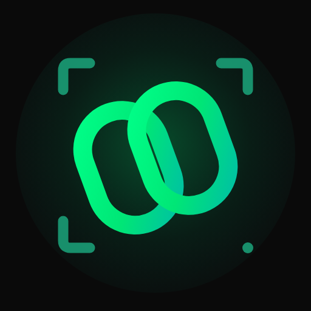

<div align="center">



# LynkShare

**Encrypted file sharing for Android and the web, without an account**

[](https://github.com/mudit-palvadi/LynkShare/stargazers)
[](https://github.com/mudit-palvadi/LynkShare/network/members)
[](https://github.com/mudit-palvadi/LynkShare/issues)
[](https://github.com/mudit-palvadi/lynkshare-mobile/blob/main/LICENSE)
[](https://flutter.dev)
[](https://fastapi.tiangolo.com)

<br/>

[](https://play.google.com/store/apps/details?id=app.xynix.lynk)

[Open LynkShare in your browser](https://lynkshare.app)

</div>

---

<p align="center">
  
  
  
  
</p>

Screenshots come from the Google Play listing. Appearance can vary by release and theme.

## What is LynkShare?

LynkShare is a fast, privacy-conscious file-sharing app for Android and the web.
No account or sign-up is required. Pick your files, choose **Cloud** or
**Direct**, and connect with a QR code or short Share Code.

File contents are encrypted on the sending device and decrypted on the receiving
device. The service does not receive the file-decryption key. Cloud sharing
keeps encrypted files available to recipients while the session is active.
Direct transfer connects devices while both remain online.

## Features

### ☁️ Cloud sharing

- Upload encrypted files once and share them with one or more recipients while
  the session is active.
- Start with a sender QR, a receiving QR, or a Share Code.
- Sessions normally last 10 minutes and can be extended to 30 minutes.
- The receiving-QR flow uses Cloud delivery.

### ⚡ Direct transfer

- Connect two devices directly for an encrypted transfer while both remain
  online.
- A relay can carry encrypted traffic when a direct network path is unavailable.

### 🔗 Pairing and files

- Scan a QR with the camera, pick a QR image from the gallery, or enter a Code.
- Sender QR and receiving QR have distinct instructions.
- Select up to 10 files, review the combined size, and remove items before
  starting.
- Open received files and re-send recent transfers where the originals remain
  available.

### 🎨 Personalization

- Choose **Light**, **Dark**, or **System** appearance.
- The selected theme is saved, and **System** follows your device appearance.

### 📱 Android and web

- The native app is distributed on Android through Google Play.
- Open [lynkshare.app](https://lynkshare.app) in a browser to use LynkShare on
  other devices, including iOS.
- An internet connection is required. Nearby-device discovery and offline LAN
  sharing are not current features.

## Transfer limits

Each limit is the **combined size of all files in one transfer**, not an allowance
for each file.

| Client | Cloud | Direct |
| --- | --- | --- |
| Android, free | 15 MB | 20 MB |
| Android, unlocked | 30 MB | 50 MB |
| Website | 10 MB | 10 MB |

Transfers support up to **10 files**, subject to the combined size limit. The
service ceiling is **50 MB per transfer**. Website transfers currently have no
unlock flow. App unlocks and advertising availability follow the in-app policy;
no account or subscription is required to start sharing.

## Privacy and security

- Files are encrypted on the sending device before they leave it. The service
  does not receive the file-decryption key.
- Treat complete links, QR images and Codes as sensitive. Share them only with
  the intended recipient.
- The service processes metadata such as file names, sizes, types, transfer
  identifiers and network addresses. Encryption does not make that metadata
  private.
- Cloud sessions normally last 10 minutes and can be extended to 30 minutes.
  Encrypted objects may remain until the bucket's cleanup policy runs rather
  than disappearing at expiry.
- Direct connections can expose network addresses to the other peer and the
  connection service. A relay can observe connection metadata, not plaintext
  file contents.
- The Android app contains advertising and Google consent/privacy controls.
  Third-party SDK data practices are covered by the
  [privacy policy](https://sites.google.com/view/lynk-privacy-policy/).

Report suspected vulnerabilities privately using the
[LynkShare security policy](https://github.com/mudit-palvadi/lynkshare-mobile/blob/main/SECURITY.md),
not a public issue. No transfer tool can guarantee safety for untrusted files.

## Repository layout

This repository is the meta-repo for the three components. They are Git
submodules, not copies, so each component keeps its own history, issues and
releases.

| Submodule | Repository | Stack | What it contains |
| --- | --- | --- | --- |
| `client/` | [`lynkshare-mobile`](https://github.com/mudit-palvadi/lynkshare-mobile) | Flutter / Dart | The Android app. |
| `backend/` | [`lynkshare-backend`](https://github.com/mudit-palvadi/lynkshare-backend) | FastAPI / Python | The API and real-time service. |
| `web/` | [`lynkshare-web`](https://github.com/mudit-palvadi/lynkshare-web) | HTML / CSS / JavaScript | The browser sender and receiver. |

The submodule directories keep their short names; the repository names above
are the canonical names.

## Clone

```bash
git clone --recurse-submodules https://github.com/mudit-palvadi/LynkShare.git
cd LynkShare
```

If you cloned without submodules:

```bash
git submodule update --init --recursive
```

If you cloned before the repositories were renamed, refresh the submodule
remotes first:

```bash
git submodule sync --recursive
git submodule update --init --recursive
```

The parent repository pins a known-good commit of each component. To update to
the latest `main` of each component, run `git submodule update --remote --merge`
only when you intend to move those pins.

## Self-hosting

You can run the full stack yourself. The three parts are the mobile app, the
backend, and the web app. You do not need an account, and no credentials are
bundled into the apps.

**Requirements**

- Git
- Docker with Compose (recommended), or Python 3.10+ and Redis 7+
- Flutter **3.44.6** and the Android SDK for the mobile app
- A Cloudflare account with an R2 bucket and API token for cloud transfers

### 1. Clone the repositories

```bash
git clone --recurse-submodules https://github.com/mudit-palvadi/LynkShare.git
cd LynkShare
```

### 2. Configure and start the backend

```bash
cd backend
cp .env.example .env
```

Open `.env` and set:

- `REDIS_PASSWORD` to a long random value.
- `REDIS_URL` to use the same password.
- `R2_ACCOUNT_ID`, `R2_ACCESS_KEY_ID`, `R2_SECRET_ACCESS_KEY` and
  `R2_BUCKET_NAME` to your own bucket.
- `ALLOWED_ORIGINS` to include the address where you serve the web app.

Then start the stack:

```bash
docker compose up -d
```

The API listens on `http://localhost:8000`. The Compose stack requires
`REDIS_PASSWORD` and refuses to start without it. If you prefer not to use
Docker, the
[backend README](https://github.com/mudit-palvadi/lynkshare-backend#manual-setup)
has the manual Python and Redis steps.

Direct transfers work on many networks. To improve connectivity across
restrictive networks, set `TURN_URLS` and `TURN_SECRET` in `backend/.env`.

### 3. Run the Android app

```bash
cd ../client
cp .env.example .env
```

Set `API_BASE_URL` to the API base of your backend. `.env.example` contains the
correct value for the Android emulator; change only the host when you run on a
physical device or the web build:

- **Android emulator:** keep `10.0.2.2`.
- **Web or desktop:** use `localhost`.
- **Physical Android device:** run `adb reverse tcp:8000 tcp:8000` and use
  `localhost`, or use your computer's LAN address.

Then run:

```bash
flutter pub get
flutter run
```

### 4. Run the web app

```bash
cd ../web
```

The browser app reads its API origin from the `lynk-api-base` meta tag in
`app/send.html` and `app/receive.html`. Set both to your backend origin, for
example `http://localhost:8000`.

Serve the site with the included development server:

```bash
python tools/dev_server.py 3000
```

Open `http://localhost:3000`. The server handles the deep-link paths used by the
receiver page. The default backend `ALLOWED_ORIGINS` already includes this port;
if you serve the web app on another port, add that origin to `ALLOWED_ORIGINS`
in `backend/.env`.

### 5. Try a transfer

Open the Android app and the web app, send a small file, and confirm it arrives.
Cloud transfers need the R2 bucket; direct transfers need both devices online.

## Troubleshooting

- **Compose says `REDIS_PASSWORD` is missing.** Set it in `backend/.env`; the
  Compose stack refuses to start without it.
- **The Android emulator cannot reach the backend.** Use `10.0.2.2` instead of
  `localhost`.
- **A physical device cannot reach the backend.** Run
  `adb reverse tcp:8000 tcp:8000` or use your computer's LAN address.
- **The web app cannot reach the backend.** Check the `lynk-api-base` meta tag
  in both page templates and the backend's `ALLOWED_ORIGINS`.
- **Cloud transfers fail.** Check the R2 bucket name and API token in
  `backend/.env`.
- **Direct transfers fail on a restrictive network.** Configure TURN in
  `backend/.env`; cloud delivery remains available as a fallback.

## Contributing

Contributions are welcome in any of the three repositories. Open issues and pull
requests in the repository that owns the change:

- [Mobile](https://github.com/mudit-palvadi/lynkshare-mobile/issues)
- [Backend](https://github.com/mudit-palvadi/lynkshare-backend/issues)
- [Web](https://github.com/mudit-palvadi/lynkshare-web/issues)

For security reports, use the
[LynkShare security policy](https://github.com/mudit-palvadi/lynkshare-mobile/blob/main/SECURITY.md).
Do not open a public issue containing vulnerability details.

## Support the project

- ⭐ Star this repository and the component repositories.
- 💬 Leave a review on [Google Play](https://play.google.com/store/apps/details?id=app.xynix.lynk).
- 🐛 [Report a bug or suggest a feature](https://github.com/mudit-palvadi/LynkShare/issues).

## License

The LynkShare mobile app is released under the
[GNU General Public License v3.0 only](https://github.com/mudit-palvadi/lynkshare-mobile/blob/main/LICENSE)
(`GPL-3.0-only`). The backend and web repositories do not currently declare a
license; check each repository before redistributing or reusing their code.

---

<div align="center">

**[lynkshare.app](https://lynkshare.app)** &nbsp;·&nbsp; [Google Play](https://play.google.com/store/apps/details?id=app.xynix.lynk) &nbsp;·&nbsp; [Privacy Policy](https://sites.google.com/view/lynk-privacy-policy/) &nbsp;·&nbsp; [Security Policy](https://github.com/mudit-palvadi/lynkshare-mobile/blob/main/SECURITY.md)

Made with ❤️ by [Mudit Palvadi](https://github.com/mudit-palvadi)

</div>
